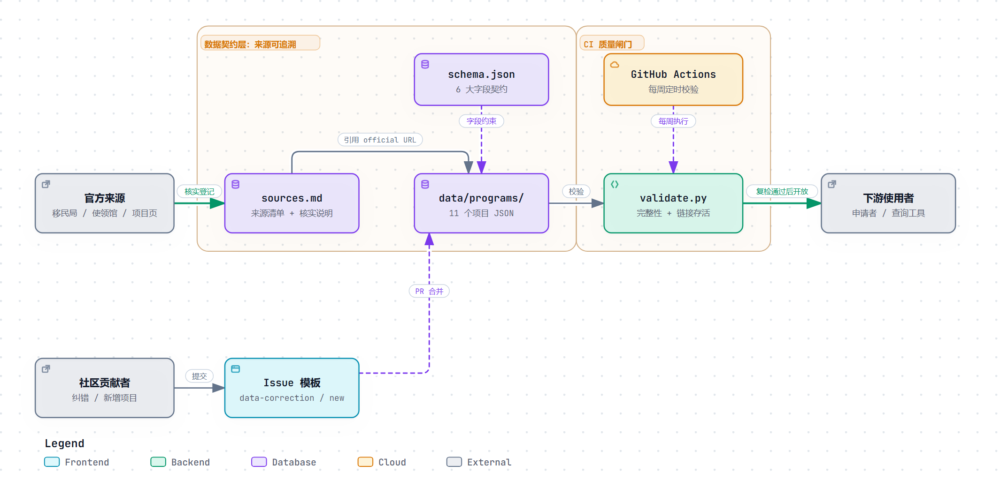

# 海外青年流动项目数据集 · Overseas Youth Mobility Program Dataset

> 一个带官方来源追溯与时效校验的开放数据集，专门解决华语世界关于「海外打工度假 / 海外实习签证」的信息污染问题。

[](https://github.com/eddieye1004/overseas-program-dataset/actions/workflows/validate.yml)
[](https://creativecommons.org/licenses/by/4.0/)
[](LICENSE)

**在线浏览：<https://eddieye1004.github.io/overseas-program-dataset/>** —— 中英双语，手机上能直接筛。不想读 JSON 就从这里进。

---

## 解决什么问题

中文互联网上搜「打工度假签证」，会搜到大量互相矛盾的文章，普遍存在同一个系统性错误：

> **把只对中国台湾 / 中国香港护照开放的项目，写成「中国公民可申请」。**

加拿大 IEC、英国 YMS、爱尔兰 WHA、日本 WH、韩国 H-1 都是双边互惠协议，对方只开放给与其签约的国家/地区护照持有人，**中国大陆护照不在名单内**。而大量攻略、中介软文、AI 生成内容仍在把它们列成「中国护照可申请」。

结果是：一个大陆学生花三个月准备材料，最后发现项目根本不接受他的护照。

本数据集只做一件事——**让每一条资格信息都能追溯到一个官方来源，并标注核实日期。**

| 是 | 不是 |
|---|---|
| 一份**带来源标注**的结构化项目数据 | 一个签证代办服务 |
| 一份**可被社区贡献和维护**的开放数据 | 一份静态的、会过期的攻略 |
| 一个**自动化校验**的数据集（CI 检查链接存活与来源等级） | 一个查询工具（工具是它的下游） |
| 面向**中国大陆护照**持有者的**护照 × 身份 × 年龄**三维资格判定 | 面向所有护照的通用列表 |

**设计原则**

1. **来源可追溯** — 每条资格数据必须附带官方 URL
2. **时效可验证** — 每条数据必须标注 `last_verified` 核实日期
3. **护照优先，但不只看护照** — 护照决定 90% 的结果，剩下 10% 由**身份**（在校 / 毕业 2 年内 / 在职）与**年龄**决定。三条一起才是真实边界
4. **显式排除** — 明确记录「哪些项目大陆护照不能申请」，而不只是列出能申请的

**收录标准**：只收录**有政府官方页面作为依据**的项目，每条记录至少 1 条 A 级来源，校验器强制。私立语言学校、留学中介、培训机构（EF、Kaplan 等）**不作为来源**，也不单列机构名录——本库没有能力判断机构是否合法办学，列出来等于背书。所以游学类只收签证环节，英国短期学习签证就是这一类。

---

## 数据覆盖

| 项目 | 国家/地区 | 类型 | 大陆护照 |
|---|---|---|---|
| Work and Holiday Visa (462) | 澳大利亚 | 打工度假 | ✅ |
| China Working Holiday Visa | 新西兰 | 打工度假 | ✅ |
| Working Holiday Programme | 日本 | 打工度假 | ❌ 不可申请 |
| H-1 Working Holiday Visa | 韩国 | 打工度假 | ❌ 不可申请 |
| Work Holiday Programme | 新加坡 | 打工度假 | ❌ 不可申请 |
| IEC Working Holiday | 加拿大 | 打工度假 | ❌ 不可申请 |
| Youth Mobility Scheme | 英国 | 打工度假 | ❌ 不可申请 |
| Working Holiday Authorisation | 爱尔兰 | 打工度假 | ❌ 不可申请 |
| Summer Work Travel (J-1) | 美国 | 带薪实习 | ✅ |
| Intern (J-1) | 美国 | 带薪实习 | ✅ |
| Trainee (J-1) | 美国 | 在职培训 | ✅ |
| Camp Counselor (J-1) | 美国 | 文化交流 | ✅ |
| Study-related Internship (§16e) | 德国 | 实习签证 | ✅ |
| Opportunity Card (Chancenkarte) | 德国 | 求职居留 | ✅ |
| IAESTE 国际实习 | 全球 100+ 国 | 技术实习 | ✅ |
| AIESEC Global Talent | 全球 120+ 国 | 企业实习 | ✅ |
| Graduate Visa | 英国 | 毕业后工作 | ✅ |
| Short-term study visa | 英国 | 短期游学 | ✅ |
| Job-search permit (§20) | 德国 | 毕业后求职 | ✅ |
| Optional Practical Training (OPT) | 美国 | 毕业后工作 | ✅ |
| Temporary Graduate visa (485) | 澳大利亚 | 毕业后工作 | ✅ |
| Post-graduation work permit (PGWP) | 加拿大 | 毕业后工作 | ✅ |
| Post Study Work Visa | 新西兰 | 毕业后工作 | ✅ |
| High Potential Individual (HPI) | 英国 | 毕业后工作 | ✅ |
| Research Scholar (J-1) | 美国 | 研究交流 | ✅ |
| Orientation year (zoekjaar) | 荷兰 | 毕业后求职 | ✅ |

**26 个项目，大陆护照可申 20 / 不可申 6，共 109 条来源（A 级 98 / B 级 6 / C 级 5），其中 5 条 C 级仅作旁证。** 数字取于 2026-11-08，改数据后重跑 `python scripts/gen_sources.py`。

完整清单见 [`data/programs/`](data/programs/)，逐条来源见 [`data/sources.md`](data/sources.md)。

---

## 数据格式

每个项目一个 JSON 文件，结构定义见 [`data/schema.json`](data/schema.json)：

| 部分 | 说明 |
|---|---|
| `program` | 项目基本信息（名称、国家、签证代码、官方网址、标签） |
| `eligibility` | 资格条件（护照类型、年龄、学历、语言、资金、其他要求） |
| `timeline` | 时间窗口（开放日、名额、费用、申请机制、审理周期） |
| `documents` | 所需材料清单 |
| `steps` | 申请流程步骤 |
| `work_conditions` | 工作限制（停留时长、同雇主上限、可否续签） |
| `risks` | 关键风险（名额、一次性机会、拒签成本等） |
| `sources` | **官方来源 URL + 核实日期 + 核实人 + 该条来源支撑的具体断言** |

`sources` 是本数据集区别于普通攻略的核心字段——**没有来源的数据不予合并**。每条来源按可信度分四级：

| 级 | 含义 | 能否单独支撑硬性资格判定 |
|---|---|---|
| A | 政府/移民局/使领馆/官方法规库 | ✅ 必须至少 1 条 |
| B | 项目本体国际组织官网（IAESTE、AIESEC 等） | 可作为旁证 |
| C | 高校官方部门、其他可核验机构 | ❌ 仅旁证 |
| D | 百科、自媒体、商业博客、来源不明 | ❌ 出现即 CI 失败 |

---

## 使用

```bash
git clone https://github.com/eddieye1004/overseas-program-dataset.git
```

只想看数据、不想用网页的，`data/programs/*.json` 就是全部内容。

**跑网页**

```bash
cd web
pnpm install
pnpm dev          # 本地开发
pnpm build        # 产出静态站到 web/dist
```

`pnpm dev` 前会先跑 `scripts/sync-data.mjs`，把 `data/programs/*.json` 合并成前端加载的三个 JSON；同一命令链还会跑 `scripts/gen-pages.mjs`，为每个项目生成一个真实路径的静态页 `web/public/p/<id>.html`（不是 `#/p/<id>` 片段链接，搜索引擎能单独收录）。改完数据重跑一次即可，不用碰前端代码。

**本地校验**

```bash
python scripts/validate.py                  # 数据完整性与格式（离线）
python scripts/validate.py --check-links    # 同时检查官方链接存活（需网络）
python -m pytest -q                         # 校验器自身的 70 个测试
node web/scripts/smoke-test.mjs             # 前端纯逻辑断言
```

---

## 仓库结构

```
overseas-program-dataset/
├── README.md                    # 你在这里
├── CONTRIBUTING.md              # 如何贡献数据
├── CHANGELOG.md                 # 数据变更记录
├── LICENSE / LICENSE-DATA       # 代码 MIT / 数据 CC BY 4.0
├── data/
│   ├── schema.json              # 数据字段定义（机器可读）
│   ├── sources.md               # 官方来源清单（gen_sources.py 生成，勿手改）
│   └── programs/                # 每个项目一个 JSON
├── scripts/
│   ├── validate.py              # 完整性 + 来源分级 + 链接存活
│   └── gen_sources.py           # 从 programs/*.json 生成 sources.md
├── tests/test_validate.py       # 校验器自身的测试
├── web/                         # 中英双语静态站（React + Vite）
│   ├── src/                     # 页面、筛选、智能匹配、i18n、首访引导
│   ├── public/p/                # gen-pages.mjs 生成的静态详情页（每项目一个真路径）
│   └── scripts/                 # sync-data / gen-pages / smoke-test / e2e-check
└── .github/workflows/           # validate.yml 每周校验 / pages.yml 部署
```



左侧是**数据契约层**——每条资格判定都要能追到一个官方 URL；右侧是 **CI 质量闸门**——每周自动复查这些链接是否失效。社区纠错从 Issue 模板进来，经 PR 合并回数据层。

---

## 贡献

请先阅读 [`CONTRIBUTING.md`](CONTRIBUTING.md)。最重要的一条：

> 每一条资格判定，都必须能指向一个**官方来源**（移民局官网 / 驻华使领馆 / 项目官方页面）。
> 二手来源（中介网站、公众号、AI 生成内容）**不作为依据**。

数据纠错请用 [Issue 模板](.github/ISSUE_TEMPLATE/data-correction.md)。

---

## 免责声明

- 本数据集为**信息汇编**，不构成法律或移民建议。
- 各国政策、名额、费用、开放时间**随时可能调整**，申请前请以官方最新公告为准。
- `last_verified` 表示该条信息的最后核实日期，**不保证在此之后仍然有效**。
- 部分官方站点（如日本外务省 `mofa.go.jp`、加拿大 IRCC `canada.ca`）会对脚本式请求返回 403 或连接重置。这类站点用真实浏览器通道仍可读到原文，本数据集据此复核。有些字段国家级页面确实不写（如材料规格由各使领馆自定、项目费由各 Sponsor 自定），这类字段写明「官方未规定、该向谁确认」，**不填一个看似合理的数字**。

---

## 许可

- **数据**（`data/`）：[CC BY 4.0](LICENSE-DATA) — 可自由使用，需署名
- **代码**（`scripts/`、`tests/`、`web/`）：[MIT](LICENSE)

仓库采用 SPDX 标准的多许可布局：根目录 `LICENSE` 只放 MIT 全文（GitHub 据此识别代码许可），数据许可全文单独放在 `LICENSE-DATA`。第三方复用数据时请引用本仓库 URL 与 `last_verified` 日期。
