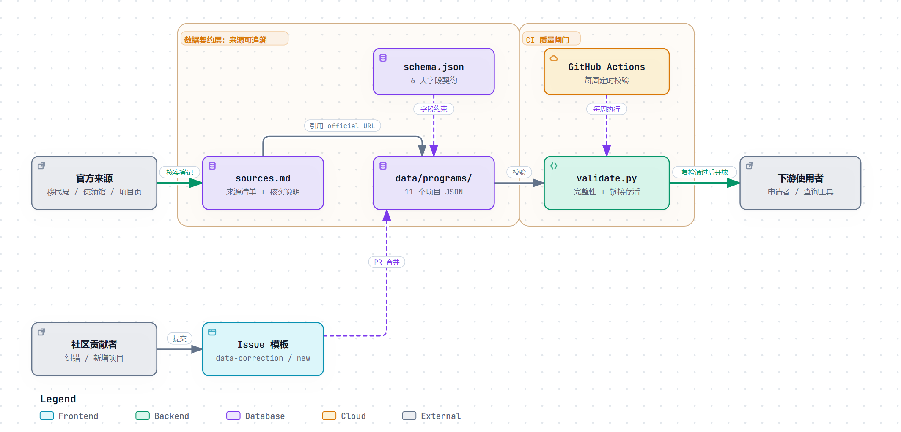

# 海外青年流动项目数据集 · Overseas Youth Mobility Program Dataset

> **一个带官方来源追溯与时效校验的开放数据集，专门解决华语世界关于"海外打工度假 / 海外实习签证"的信息污染问题。**

[](https://github.com/eddieye1004/overseas-program-dataset/actions/workflows/validate.yml)
[](https://creativecommons.org/licenses/by/4.0/)
[](LICENSE)

---

## 为什么做这个项目

你在中文互联网上搜索"打工度假签证"，会搜到大量互相矛盾的文章。它们普遍存在一个**系统性错误**：

> **把只对中国台湾 / 中国香港护照开放的项目，写成"中国公民可申请"。**

例如"加拿大打工度假""英国青年流动计划""爱尔兰打工度假"，这些都是**双边互惠协议**——对方只开放给与其签约的国家/地区护照持有人。**中国大陆护照并不在名单内。** 而大量中文攻略、留学中介软文、AI 生成内容，仍在把它们列成"中国护照可申请"。

**结果是：一个大陆学生花了三个月准备材料，最后发现项目根本不接受他的护照。**

这个数据集要解决的，就是这一个问题：

> **让每一条资格信息都能被追溯到一个官方来源，并标注核实日期。**

---

## 这个数据集是什么（以及不是什么）

| 是 | 不是 |
|---|---|
| 一份**带来源标注**的结构化项目数据 | 一个签证代办服务 |
| 一份**可被社区贡献和维护**的开放数据 | 一份静态的、会过期的攻略 |
| 一个**自动化校验**的数据集（CI 检查链接存活） | 一个查询工具（工具是它的下游） |
| 面向**中国大陆护照**持有者的准确资格判定 | 面向所有护照的通用列表 |

**设计原则：**
1. **来源可追溯** — 每条资格数据必须附带官方 URL
2. **时效可验证** — 每条数据必须标注 `last_verified` 核实日期
3. **护照优先** — 护照类型是第一筛选维度，因为它决定 90% 的结果
4. **显式排除** — 明确记录"哪些项目大陆护照不能申请"，而不只是列出能申请的

---

## 数据覆盖范围

| 项目 | 国家/地区 | 类型 | 大陆护照 |
|---|---|---|---|
| Work and Holiday Visa (462) | 澳大利亚 | 打工度假 | ✅ |
| China Working Holiday Visa | 新西兰 | 打工度假 | ✅ |
| Working Holiday Programme | 日本 | 打工度假 | ❌ 不可申请 |
| H-1 Working Holiday Visa | 韩国 | 打工度假 | ❌ 不可申请 |
| Summer Work Travel (J-1) | 美国 | 带薪实习 | ✅ |
| Study-related Internship (§16e) | 德国 | 实习 | ✅ |
| IAESTE 国际实习 | 全球 80+ 国 | 技术实习 | ✅ |
| AIESEC Global Talent | 全球 120+ 国 | 企业实习 | ✅ |
| IEC Working Holiday | 加拿大 | 打工度假 | ❌ 不可申请 |
| Youth Mobility Scheme | 英国 | 打工度假 | ❌ 不可申请 |
| Working Holiday Authorisation | 爱尔兰 | 打工度假 | ❌ 不可申请 |

> 完整清单见 [`data/programs/`](data/programs/)

---

## 仓库结构

```
overseas-program-dataset/
├── README.md                    # 你在这里
├── CONTRIBUTING.md              # 如何贡献数据
├── CHANGELOG.md                 # 数据变更记录
├── LICENSE                      # 数据 CC BY 4.0 / 代码 MIT
├── data/
│   ├── schema.json              # 数据字段定义（机器可读）
│   ├── sources.md               # 官方来源清单与核实说明
│   └── programs/                # 每个项目一个 JSON 文件
│       ├── au-462-work-holiday.json
│       ├── nz-china-whv.json
│       └── ...
├── scripts/
│   └── validate.py              # 数据完整性 + 官方链接存活校验
└── .github/
    ├── workflows/validate.yml   # 每周自动校验
    └── ISSUE_TEMPLATE/          # 数据纠错 / 新增项目模板
```

### 架构图



> 左侧是**数据契约层**——每条资格判定都要能追到一个官方 URL；右侧是 **CI 质量闸门**——每周自动复查这些链接是否失效。社区纠错从 Issue 模板进来，经 PR 合并回数据层。

---

## 快速开始

### 使用数据

```bash
git clone https://github.com/eddieye1004/overseas-program-dataset.git
```

数据文件为 JSON 格式，结构定义见 [`data/schema.json`](data/schema.json)。

### 本地校验

```bash
# 仅校验数据完整性与格式（离线）
python scripts/validate.py

# 同时检查官方链接是否存活（需要网络）
python scripts/validate.py --check-links

# 输出 JSON 格式报告
python scripts/validate.py --json
```

---

## 数据说明

每条项目数据包含 6 个部分：

| 部分 | 说明 |
|---|---|
| `program` | 项目基本信息（名称、国家、签证代码、官方网址） |
| `eligibility` | 资格条件（护照、年龄、学历、语言、资金…） |
| `timeline` | 时间窗口（开放日、截止日、名额、费用、申请机制） |
| `documents` | 所需材料清单 |
| `steps` | 申请流程步骤 |
| `sources` | **官方来源 URL + 核实日期 + 核实人** |

其中 `sources` 是本数据集区别于普通攻略的核心字段——**没有来源的数据不予合并。**

---

## 贡献

欢迎提交数据纠错或新增项目。请先阅读 [`CONTRIBUTING.md`](CONTRIBUTING.md)。

**最重要的一条贡献规则：**
> 每一条资格判定，都必须能指向一个**官方来源**（移民局官网 / 驻华使领馆 / 项目官方页面）。
> 二手来源（中介网站、公众号、AI 生成内容）**不作为依据**。

如发现数据错误，请使用 [数据纠错模板](.github/ISSUE_TEMPLATE/data-correction.md) 提交。

---

## 免责声明

- 本数据集为**信息汇编**，不构成法律或移民建议。
- 各国政策、名额、费用、开放时间**随时可能调整**，申请前请以官方最新公告为准。
- 数据中的 `last_verified` 字段表示该条信息的最后核实日期，**不保证在此之后仍然有效**。

---

## 许可

- **数据**（`data/` 目录）：[CC BY 4.0](https://creativecommons.org/licenses/by/4.0/) — 可自由使用，需署名
- **代码**（`scripts/`）：[MIT](LICENSE)

---

## 致谢

本数据集最初源于一个个人困惑：**为什么中文世界关于打工度假的信息如此混乱？**
如果你也因为错误信息浪费过时间，欢迎一起把它修好。
